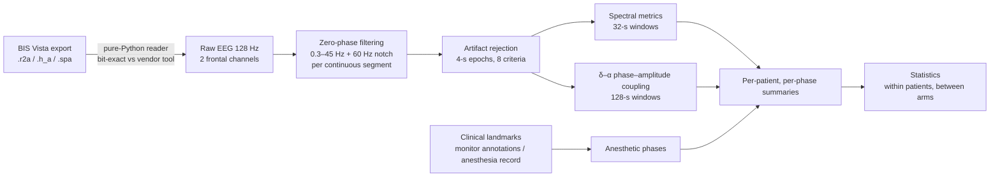
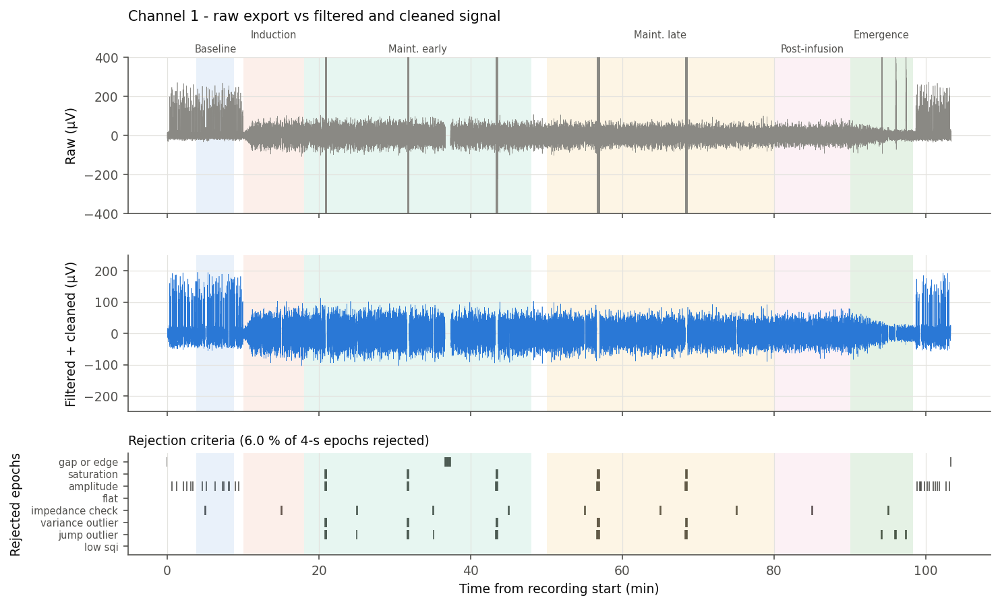
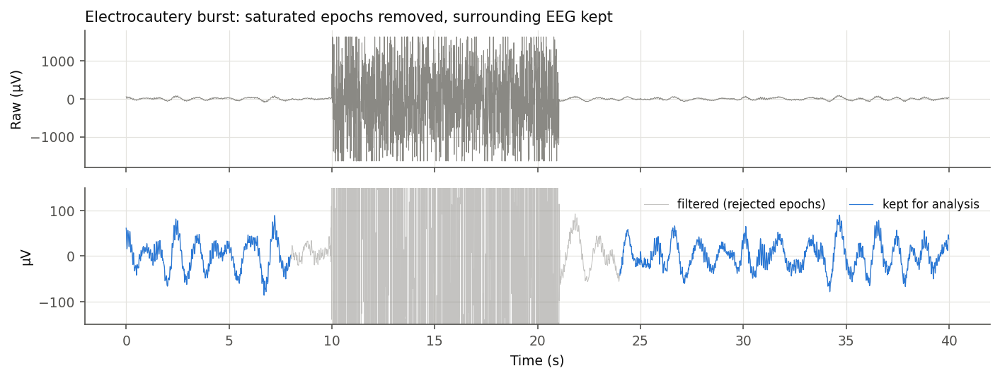
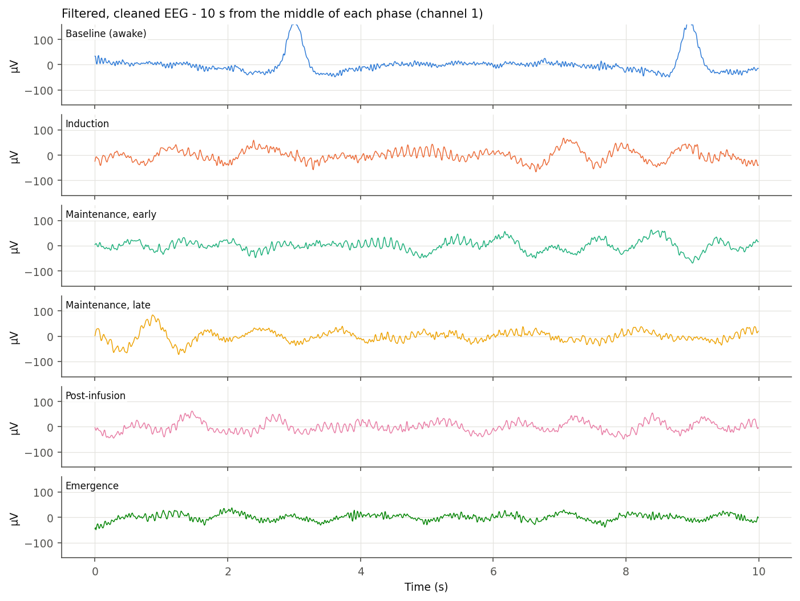
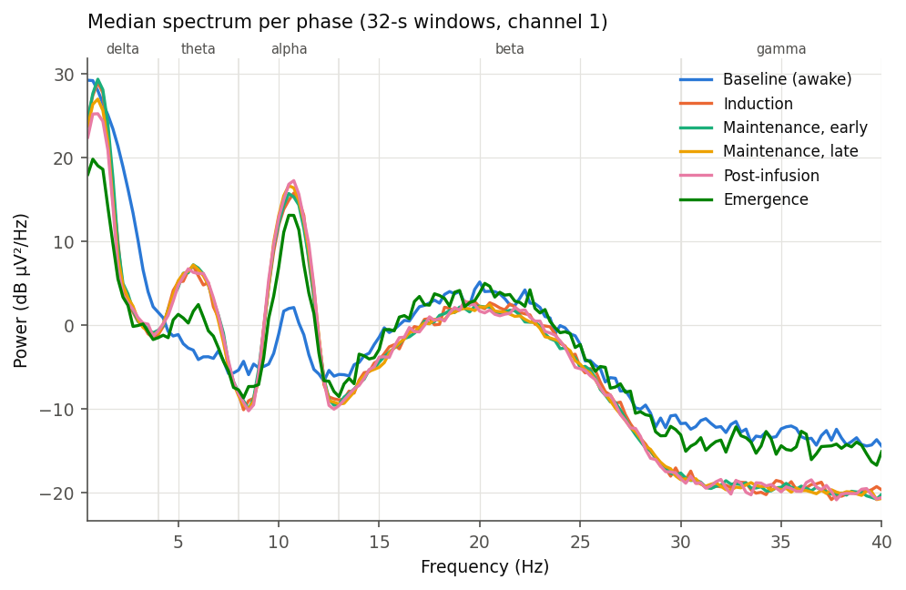
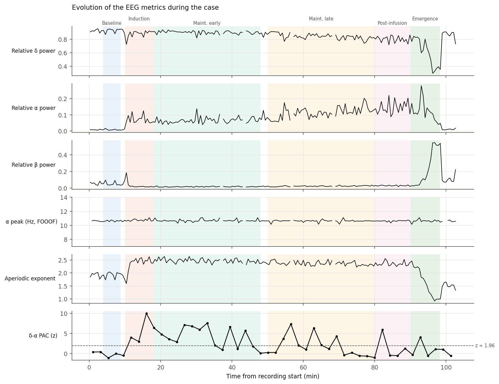
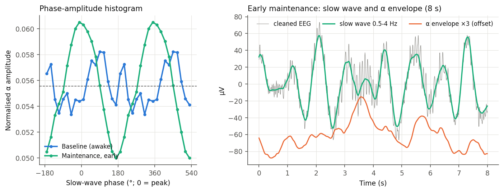

# Intraoperative EEG processing pipeline

A Python pipeline that turns the **raw frontal EEG from a BIS Vista monitor** into clean signals, spectral/aperiodic/phase–amplitude-coupling metrics per anesthetic phase, and patient- and group-level statistics.

I built it during my postdoc for an ongoing randomized, placebo-controlled clinical trial of an adjunct drug given during propofol–remifentanil total intravenous anesthesia. The full study pipeline processes tens of multi-hour surgical recordings. It synchronizes the EEG with a nociception monitor, the anesthesia record and the infusion-pump logs, and it produces per-patient figures and workbooks, cohort tables and a methods report.

> **No patient data in this repository.** The trial data are confidential. Every figure below was produced by running the pipeline on a **synthetic recording** (`eegpipe/simulate.py`) that mimics the typical features of a propofol anesthetic. Study-specific code (file mapping, clinical-database parsing, device synchronization tables) and all trial results are left out. This repo shows the methods and the code.

---

## What the pipeline does



| Step | Method | Why |
|---|---|---|
| **Reading** | BIS Vista binary export decoded in Python: int16 interleaved samples, gain/offset from the 2048-byte header, µV = (AD − offset) × gain. Time-stamped from the 1-Hz `.spa` file (one row = 128 samples). | The vendor's reader is a MATLAB runtime. This reader was validated sample by sample against it (max difference 0 µV). |
| **Synchronization** *(study code, not published)* | EEG, nociception monitor, anesthesia record and pump logs aligned on a common clock. Checked by the EEG↔monitor-EMG lag (constant 3–4 s), the pump-vs-monitor clock and the BIS drop after induction. | Metrics must be attributed to the right drug concentration and clinical phase. |
| **Filtering** | Butterworth band-pass 0.3–45 Hz (order 4, `sosfiltfilt`) + 60-Hz notch, applied **separately to each continuous segment**. The 2-s edges are flagged. | Zero phase keeps waveform timing. Filters never run across a disconnection. |
| **Artifact rejection** | 4-s epochs rejected on: gap/edge, amplifier saturation (raw A/D), \|x\| > 200 µV, flat line, the monitor's impedance check (shared across channels), local robust-z outliers of variance and of sample-to-sample jumps (median/MAD over ±5 min), and low monitor signal quality. | Each rejected epoch has a traceable reason. The local z compares awake EEG with awake EEG and anesthetized with anesthetized. |
| **Spectra** | Hann periodogram per clean epoch, averaged over 32-s windows (≥ 50 % clean). Absolute, relative and dB power in δ, θ, α, β and γ. Peak frequency = local maximum (NaN on a band edge). | These are standard propofol EEG signatures, e.g. frontal α and slow waves (Purdon et al., 2013). |
| **Aperiodic / periodic** | FOOOF, 1–40 Hz, fixed knee: aperiodic offset and exponent, plus the strongest oscillatory θ/α/β peak above the 1/f background. | Separates changes in the 1/f slope (linked to the excitation/inhibition balance) from true oscillations (Donoghue et al., 2020). |
| **Phase–amplitude coupling** | Slow-wave (0.5–4 Hz) phase and α (8–13 Hz) envelope from the **cleaned** EEG, one clean segment at a time with 2-s margins removed. Tort modulation index on 128-s windows, with a z-score from 200 circularly shifted surrogates. | δ–α coupling tracks anesthetic depth. Computing it only on clean segments prevents artifacts from creating spurious coupling. |
| **Phases** | Baseline, induction, early/late maintenance, post-infusion and emergence, built from time-stamped clinical landmarks (with a fallback source re-aligned to the same clock). A patient×phase value needs ≥ 2 windows. | Compares like with like across patients. |
| **Statistics** | *Within patients*: Wilcoxon signed-rank (rank-biserial r, Hodges–Lehmann shift), Holm then Benjamini–Hochberg, Friedman, linear mixed models `metric ~ phase + (1\|patient)`. *Between arms*: Mann–Whitney with bootstrap CIs of the median difference and of Cliff's δ; mixed models `metric ~ arm × phase`, unadjusted (primary), adjusted for pre-randomization covariates, and adjusted for drug targets (secondary, since targets are post-randomization mediators); leave-one-out sensitivity analyses. | Patients are the unit of inference, so the autocorrelated 32-s windows are never treated as independent. `fit_mixed` tries four optimizers and falls back to cluster-robust OLS when the random-intercept variance collapses to zero. |

---

## Example output (synthetic recording)

Produced by `python examples/run_demo.py`: a 103-min synthetic case with eye blinks, electrocautery bursts that saturate the amplifier, the monitor's periodic impedance checks, a 40-s disconnection and emergence movement.

**Raw export vs filtered and cleaned signal, with the reason each epoch was rejected**


**Zoom on an artifact: only the contaminated epochs are removed**


**Filtered, cleaned EEG in each anesthetic phase**


**Median spectrum per phase**


**Time course of the metrics** (relative power, FOOOF α peak, aperiodic exponent, δ–α coupling)


**δ–α phase–amplitude coupling**


The cohort statistics workflow runs on a simulated table of patient × phase medians in `examples/group_stats_demo.py`. No true arm effect is simulated.

---

## Verification

- **Reader:** decoding is identical to the vendor's MATLAB reader (0 µV difference). A round-trip test writes and reads the binary format.
- **Unit tests** (`tests/`, 14 tests, all passing), each on a signal with a known answer:
  - the filter leaves 10 Hz untouched and attenuates 60 Hz by more than 40 dB, and it never crosses a gap;
  - each rejection criterion fires on its own artifact;
  - tone power is recovered within 1 %;
  - FOOOF recovers a known 1/f exponent and α peak;
  - PAC detects coupling, reports none when there is none, and never uses rejected samples;
  - phases are placed correctly;
  - the mixed model recovers a known effect.
- **Independent audit:** in the study, every step was re-implemented with separate code and the outputs compared. The audit found two real issues, and both are fixed and covered by tests here:
  - artifact samples leaking into the PAC filters;
  - an optimizer stopping at a boundary optimum in a mixed model.

---

## Repository layout

```
eegpipe/
  bis_vista.py      BIS Vista binary reader (+ writer for synthetic tests)
  preprocessing.py  segment-wise filtering, 8-criterion epoch rejection
  spectral.py       periodograms, band powers, peak frequency, FOOOF
  pac.py            Tort modulation index, surrogate z-scores
  phases.py         anesthetic phases from clinical landmarks
  pipeline.py       end-to-end processing of one recording
  stats.py          Wilcoxon / Mann–Whitney effect sizes, multiplicity, robust mixed models
  plots.py          figures
  simulate.py       synthetic intraoperative EEG (demo and tests)
  params.py         every processing constant in one place
examples/
  run_demo.py           full pipeline on a synthetic case -> figures/
  group_stats_demo.py   cohort statistics on a simulated table
tests/
  test_pipeline.py
```

## Quick start

```bash
pip install -r requirements.txt
python examples/run_demo.py          # ~15 s, writes figures/
python examples/group_stats_demo.py
python -m pytest -q
```

Python ≥ 3.10 · NumPy · SciPy · pandas · statsmodels · matplotlib · FOOOF.

## References

- Purdon PL et al. *Electroencephalogram signatures of loss and recovery of consciousness from propofol.* PNAS 2013;110:E1142–51.
- Donoghue T et al. *Parameterizing neural power spectra into periodic and aperiodic components.* Nat Neurosci 2020;23:1655–65.
- Tort ABL et al. *Measuring phase-amplitude coupling between neuronal oscillations of different frequencies.* J Neurophysiol 2010;104:1195–1210.
- Gao R, Peterson EJ, Voytek B. *Inferring synaptic excitation/inhibition balance from field potentials.* NeuroImage 2017;158:70–78.

## License

MIT. See [LICENSE](LICENSE).
